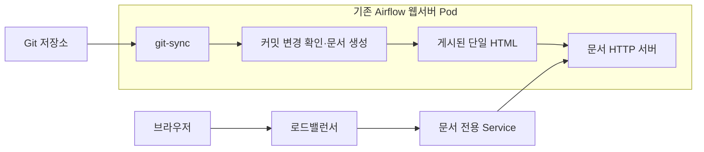

dbt 모델과 문서를 작성한 뒤에는 팀에서 편하게 열어볼 수 있는 주소가 필요했습니다. 처음에는 Pod 안에서 Python HTTP 서버를 띄우고 포트 포워딩으로 접근했습니다. 제가 확인할 때는 쓸 수 있었지만, 문서를 볼 때마다 연결을 준비해야 했습니다.

이번 작업에서는 기존 Airflow 환경에 dbt Docs를 상시 제공하고, Git에 반영한 모델과 설명이 문서에도 따라오도록 구성했습니다. 상시 접속 경로를 연결한 뒤에는 로드밸런서의 상태 확인 요청과 함께 반복된 연결 종료 오류를 조사했고, 문서 제공과 헬스체크를 분리했습니다.

아래 코드와 설정은 설명에 필요한 부분만 남겼습니다. 시스템 이름과 경로는 일반화했습니다.

## 기존 git-sync를 문서 갱신에도 사용했습니다

당시 Airflow는 git-sync로 저장소의 DAG와 dbt 프로젝트를 받아오고 있었습니다. 문서 때문에 이미지까지 매번 다시 빌드할 필요는 없었습니다.

처음에는 Airflow DAG에서 문서를 생성하고 오브젝트 스토리지에 올리는 방식도 검토했습니다. 다만 모델과 문서가 자주 바뀌는 상황에서, 이미 사용 중인 Git 동기화 흐름에 문서 갱신도 연결하고 싶었습니다. 별도 업로드 경로를 만들기 전에 기존 Pod에서 생성과 제공을 함께 처리하는 구성을 선택했습니다.

기존 Airflow 웹서버 Pod에 문서용 컨테이너를 두고, 그 안에서 두 작업을 실행했습니다. 한쪽에서는 Git 커밋 변경을 확인하고 문서를 생성합니다. 다른 쪽에서는 마지막으로 게시한 HTML을 HTTP로 제공합니다.



문서 생성에는 `dbt docs generate --static`을 사용했습니다. 이 작업에서 사용한 dbt Core 1.x 기준으로, 문서 생성은 프로젝트를 컴파일하고 데이터베이스의 카탈로그 정보를 조회합니다. `--static`은 문서에 필요한 정보를 하나의 HTML 파일에 담습니다. 모델 실행을 위한 `dbt run`이나 `dbt build`는 이 갱신 과정에 넣지 않았습니다. 카탈로그 조회에 필요한 연결과 권한은 있어야 합니다. [dbt Core 1.x 문서 생성 명령 설명](https://github.com/dbt-labs/docs.getdbt.com/blob/current/website/docs/reference/commands/cmd-docs.md)

단일 HTML을 사용하면 게시할 때 여러 파일의 버전을 맞출 필요가 없습니다. 문서 생성이 끝난 파일 하나를 교체하는 것으로 갱신을 끝낼 수 있었습니다.

## 생성 중인 문서는 공개하지 않도록 했습니다

git-sync는 체크아웃 결과를 가리키는 심볼릭 링크를 제공합니다. 링크 대상 경로의 마지막 디렉터리 이름은 커밋 해시입니다. 저는 이 값을 마지막 게시 커밋과 비교해 갱신 여부를 판단했습니다. [git-sync의 링크와 디렉터리 계약](https://github.com/kubernetes/git-sync)

빌드를 시작할 때는 링크를 한 번 해석해 실제 커밋 경로를 얻고, 그 경로에 있는 dbt 프로젝트를 임시 디렉터리로 복사했습니다. 이후 생성 작업은 복사본에서 실행합니다. 복사가 끝난 뒤 git-sync 링크가 새 커밋으로 바뀌어도 이미 시작한 빌드의 입력은 바뀌지 않습니다.

복사와 생성이 모두 성공하면 `target/static_index.html`을 게시 디렉터리의 임시 파일로 옮깁니다. 마지막에는 같은 파일시스템 안에서 `os.replace()`로 교체합니다.

```python
staging = public_dir / ".index.html.tmp"
shutil.copyfile(project / "target" / "static_index.html", staging)
os.replace(staging, public_dir / "index.html")
```

실제로 서비스 중인 `index.html`에 직접 덮어쓰지 않기 때문에, 요청이 들어온 시점에 따라 쓰다 만 HTML이 전달되는 일을 피할 수 있습니다. 마지막 게시 커밋도 이 교체가 성공한 뒤에만 기록했습니다.

생성이 실패하면 기존 문서는 그대로 둡니다. 실패한 커밋을 게시 완료로 기록하지 않으므로 다음 확인 주기에 다시 시도합니다. 빌드 도중 새 커밋이 들어왔다면 현재 빌드가 끝난 뒤 다음 주기에 확인합니다.

여기서 기존 문서를 유지한다는 범위는 프로세스가 살아 있는 동안입니다. 게시 디렉터리도 임시 디렉터리이므로 프로세스가 재시작하면 다시 생성해야 합니다. 또한 갱신 기준은 Git 커밋입니다. 같은 커밋을 유지한 채 데이터베이스의 메타데이터만 바뀌는 경우까지 자동으로 감지하지는 않습니다.

## 페이지는 열리는데 연결 종료 오류가 반복됐습니다

상시 접속 경로를 연결한 뒤 문서 페이지는 정상적으로 열렸습니다. 그런데 서버 로그에는 일정한 간격으로 다음 형태의 기록이 남았습니다.

```text
"GET / HTTP/1.1" 200 -
...
copyfile(...)
sendall(...)
ConnectionResetError: [Errno 104] Connection reset by peer
```

처음 보면 `200`으로 응답한 요청에서 왜 오류가 났는지 헷갈릴 수 있습니다. Python의 `SimpleHTTPRequestHandler`는 응답을 준비하며 요청을 기록한 뒤 파일 본문을 전송합니다. 따라서 액세스 로그에 `200`이 찍혔다는 사실만으로 본문 전체를 클라이언트가 받았다고 볼 수는 없습니다. 이번 traceback은 파일 본문을 보내는 경로에서 발생했습니다. [Python HTTP 서버의 응답 처리 설명](https://docs.python.org/3.12/library/http.server.html)

확인해 보니 로드밸런서의 헬스체크도 문서 루트인 `/`를 요청하고 있었습니다. 상태 확인 때마다 단일 HTML 본문을 내려보내는 셈입니다. 반복 주기와 요청 경로를 보고, 상태를 확인한 상대가 본문 전송 도중 연결을 닫는 상황을 의심했습니다.

로컬에서는 임의의 큰 HTML을 제공하고, TCP 클라이언트가 응답 헤더를 받은 직후 RST로 연결을 종료하도록 했습니다. 그러자 같은 본문 전송 경로에서 연결 종료 예외를 재현할 수 있었습니다.

이 실험으로 확인한 것은 상대가 응답 도중 연결을 종료하면 해당 예외가 발생할 수 있다는 점입니다. 로드밸런서가 내부적으로 본문을 어디까지 읽는지, 어떤 조건으로 연결을 닫는지까지 확인한 것은 아닙니다. 실제 환경에서 관찰한 반복 요청과 로컬 재현을 근거로 원인 가설을 좁혔습니다.

연결 종료 예외를 잡아 로그를 줄이는 수정도 시도했습니다. 최종 반영에서는 그 처리를 제거하고, 헬스체크가 문서 본문을 요청하지 않도록 바꿨습니다.

## 헬스체크에는 게시된 파일의 존재만 확인했습니다

추가한 `/healthz`는 현재 제공할 문서가 있는지만 확인합니다.

| 서버 상태 | `/healthz` 응답 |
| --- | --- |
| 시작 후 아직 문서를 게시하지 못함 | `503` |
| 문서를 한 번 이상 성공적으로 게시함 | `200` |
| 이후 갱신에 실패했지만 기존 문서가 남아 있음 | `200` |
| 프로세스 재시작으로 게시 파일이 사라짐 | 새 문서를 게시하기 전까지 `503` |

핵심 분기는 다음과 같습니다.

```python
if urlsplit(self.path).path == "/healthz":
    ready = (Path(self.directory) / "index.html").is_file()
    self.send_response(200 if ready else 503)
    self.send_header("Content-Length", "0")
    self.end_headers()
    return None
```

이 분기를 `SimpleHTTPRequestHandler`의 `send_head()`에 두어 `GET`과 `HEAD`에 같은 기준을 적용했습니다. 파일을 열거나 dbt를 실행하지 않고, 데이터베이스에도 접속하지 않습니다. 응답 본문은 비워두었고, 공통 헤더 처리에서 `Cache-Control: no-store`를 붙였습니다.

이 상태 확인은 문서의 최신성을 보장하지 않습니다. 새 커밋의 생성이 실패하더라도 기존 문서를 제공할 수 있으면 `200`입니다. 생성 실패는 갱신 로그에서 따로 확인해야 합니다.

일반 문서 요청에는 `/`와 `/index.html`만 허용했습니다. 처음 생성이 끝나기 전에는 문서 요청에도 `503`을 반환합니다.

## Service를 나눠 문서의 헬스체크 경로를 적용했습니다

서버에 `/healthz`를 추가하는 것만으로는 요청 경로가 바뀌지 않습니다. 로드밸런서가 실제로 그 주소를 확인하도록 설정해야 했습니다.

기존에는 Airflow 웹 UI와 문서 포트가 같은 Service에 있었습니다. 사용하는 NCloud ALB Ingress Controller에서는 Service에 헬스체크 관련 annotation을 둘 수 있고, Service 설정이 Ingress 설정보다 우선합니다. 이 구조에서 문서용 경로를 적용하려면 웹 UI의 상태 확인과 설정 범위를 분리하는 편이 명확했습니다. [NCloud ALB Ingress 설정 안내](https://guide.ncloud-docs.com/docs/k8s-k8sexamples-albingress)

같은 Pod를 선택하는 문서 전용 Service를 추가하고, 문서 포트만 연결했습니다. 해당 Service에는 다음 설정을 두었습니다.

```yaml
metadata:
  annotations:
    alb.ingress.kubernetes.io/healthcheck-path: /healthz
    alb.ingress.kubernetes.io/healthcheck-protocol: HTTP
    alb.ingress.kubernetes.io/healthcheck-interval-seconds: "30"
```

Ingress의 문서 경로도 이 Service로 연결했습니다. Service는 나뉘었지만 실제 프로세스는 여전히 기존 Airflow 웹서버 Pod 안에서 실행됩니다. Pod의 재시작이나 장애 영향을 분리한 구성은 아닙니다.

사용 중인 Airflow Helm chart에는 임의의 리소스를 추가할 수 있는 `extraObjects` 항목이 없었습니다. 그래서 Service 하나를 관리하는 작은 chart를 만들고 별도 Helm release로 설치했습니다. 문서의 헬스체크 설정을 바꿀 때 Airflow 전체 설정을 함께 변경하지 않아도 되는 형태입니다.

## Git 반영, 실행 중인 프로세스, 실제 경로를 따로 확인했습니다

문서 갱신용 watcher는 git-sync의 새 커밋을 감지하지만, 실행 중인 Python 서버 자체를 다시 읽지는 않습니다. 모델이나 설명 변경은 문서 재생성으로 반영됩니다. 이번처럼 HTTP 처리 코드를 바꿨을 때는 새 코드가 동기화된 것을 확인한 뒤 서버 프로세스를 재시작해야 했습니다.

Ingress 변경에도 시차가 있었습니다. 설정을 병합한 직후에는 여전히 `/` 요청과 연결 종료 오류가 보였습니다. 그때 Argo CD의 동기화 상태는 `Synced`였지만, 동기화된 리비전은 변경 전 커밋이었습니다. 자동 갱신 후 새 리비전이 적용되자 실제 Ingress 대상이 바뀌었고, 서버 로그에도 `GET /healthz`가 나타났습니다.

배포 순서에서 놓친 부분도 있었습니다. Ingress가 새 Service를 먼저 가리켰지만 해당 Service는 아직 없는 상태를 확인했습니다. 이후 서버 코드와 프로세스를 준비하고 Service를 설치한 뒤 최종 연결을 검증했습니다. 같은 변경을 다시 적용한다면 다음 순서로 진행할 것입니다.

1. 새 코드로 서버를 실행하고 내부에서 `/healthz`가 동작하는지 확인합니다.
2. 문서 전용 Service를 만들고 대상 엔드포인트가 연결됐는지 확인합니다.
3. Ingress를 새 Service로 전환합니다.
4. 로드밸런서를 거친 실제 요청과 서버 로그를 확인합니다.

## 검증한 결과와 남은 제약

로컬에서는 문서 생성과 HTTP 응답을 나누어 검증했습니다. 생성 실패·시간 초과·게시 실패 때 이전 문서가 유지되는지, 실패한 커밋을 다시 시도하는지 확인했습니다. 생성 중 git-sync 링크가 바뀌면 다음 갱신에서 새 커밋을 처리하는지도 테스트했습니다.

`/healthz`는 게시 파일이 없을 때와 있을 때를 각각 확인했습니다. `GET`과 `HEAD` 모두 상태 코드와 빈 본문이 의도대로 나오고, 문서 파일을 열지 않는 것을 테스트했습니다. 일반 요청의 예외를 일괄적으로 감추는 처리가 남지 않았는지도 확인했습니다. 관련 테스트를 포함한 단위 테스트는 모두 통과했습니다.

테스트 서버에서 검증한 뒤 운영에도 적용했습니다. 운영에서는 내부 Service를 통해 문서 본문을 끝까지 내려받아 응답의 `Content-Length`와 크기가 일치하는지 확인했습니다. `/healthz`의 `GET`·`HEAD`는 내부 Service와 로드밸런서 양쪽에서 `200`과 길이 0을 반환했습니다.

경로 전환이 반영된 뒤 테스트와 운영에서 각각 1분간 확인한 로그에는 `/healthz` 요청이 기록됐으며, 앞서 반복되던 연결 종료 예외는 관찰되지 않았습니다. 이는 적용 직후의 확인 결과이며 장기간의 안정성을 측정한 결과는 아닙니다.

이제 문서를 보기 위해 포트 포워딩을 준비할 필요가 없어졌고, Git 변경에 따라 문서도 자동으로 갱신됩니다.

HTTP 제공에는 Python 표준 라이브러리의 서버를 사용했습니다. 공식 문서는 이를 프로덕션 용도로 권장하지 않습니다. 이번 환경에서 응답과 갱신 동작을 검증한 것과 별개로, 계속 운영하려면 정적 파일 제공을 맡길 서버와 배포 단위를 다시 검토할 필요가 있습니다. [Python HTTP 서버의 사용 범위](https://docs.python.org/3.12/library/http.server.html)
